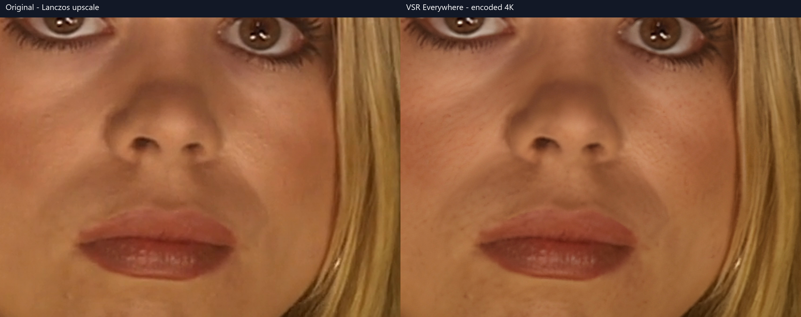

# VSR Everywhere 1.0.0

**NVIDIA Video Super Resolution for your Jellyfin server.**

Enhance lower-resolution video on a Windows server and deliver an HEVC stream to your Jellyfin clients. Choose how much resolution VSR processes, choose what resolution your player receives, and let the Windows wizard handle the runtime.

[**Download the Windows installer**](https://github.com/TomSellecksMustache/VSR-Everywhere/releases/download/v1.0.0/VSR-Everywhere-1.0.0-Setup.exe) · [All 1.0.0 downloads](https://github.com/TomSellecksMustache/VSR-Everywhere/releases/tag/v1.0.0)

[Install](INSTALL-WINDOWS.md) · [Comparisons](docs/comparisons.md) · [Settings](docs/configuration.md) · [Troubleshooting](docs/troubleshooting.md) · [Build from source](docs/development.md)

## See the difference

**Left: original with Lanczos scaling. Right: actual encoded VSR output.** Each pair uses the same decoded frame. Open an image to inspect the detail.

### Animation


### Live action



These examples use **ULTRA, strength 1, 5K processing, and 4K delivery**. They demonstrate that profile, rather than the installer's balanced defaults. Results depend on the source, settings, GPU, and player.

[View all eight comparisons and the capture method](docs/comparisons.md), including Futurama and Xena.

## What it does

| Feature | What you control |
| --- | --- |
| Independent resolutions | Processing and delivery presets from 1080p through 8K. |
| NVIDIA VSR | Enhancement quality and strength. |
| HEVC Main 10 + AAC | Hardware encoding, bitrate, and HLS format. |
| GPU processing path | Enhanced frames stay on the GPU through resize, colour conversion, and encoding when NVENC lookahead is 0. |
| Shared RAM cache | Completed HLS segments stay in a bounded memory store and regenerate when needed. |
| Device selection | Enable VSR for all devices or select registered Jellyfin devices. |
| Windows setup | Detects Jellyfin, downloads dependencies, tests the GPU pipeline, and verifies plugin loading. |

**Working frames in VRAM. Finished stream segments in RAM.** NVENC lookahead above 0 selects the compatible FFmpeg encoding path, which transfers enhanced frames through system memory. [Read how the pipeline and cache work.](docs/configuration.md)

## Install on Windows

1. Download [**VSR-Everywhere-1.0.0-Setup.exe**](https://github.com/TomSellecksMustache/VSR-Everywhere/releases/download/v1.0.0/VSR-Everywhere-1.0.0-Setup.exe).
2. Open it and approve administrator access.
3. Confirm the detected Jellyfin server.
4. Choose a download/runtime folder on a local drive with **25 GB free**. For example, selecting `G:\` creates `G:\VsrEverywhere`.
5. Select **Install**. Setup downloads the runtime, tests VSR/video/audio, installs the plugin, and briefly restarts Jellyfin.
6. Open the plugin settings in Jellyfin and start an eligible video on your chosen device.

The single EXE contains the wizard and plugin. It downloads the larger dependencies during installation; internet access is required. You do not need a separate Python installation, CUDA Toolkit, or .NET SDK to use it.

Prefer PowerShell? Keep **Install-VSREverywhere.ps1** and its matching **VSR-Everywhere-1.0.0-Windows.zip** together, then run:

```powershell
powershell.exe -NoProfile -Sta -ExecutionPolicy Bypass -File .\Install-VSREverywhere.ps1 -InstallFolder 'G:\'
```

[Full setup guide, silent installation, backups, and recovery](INSTALL-WINDOWS.md).

## Requirements

| Component | Required |
| --- | --- |
| Server OS | Windows 10 or 11, x64. |
| Jellyfin | An initialized Jellyfin 12.1 server on this PC. |
| GPU | A supported NVIDIA GPU with VSR and HEVC encoding capability; setup runs an actual video test. |
| Driver | NVIDIA 570.65 or newer. |
| Installation space | 25 GB free on the selected local NTFS/ReFS drive for a fresh runtime. Small bootstrap and Windows components still use system-drive space. |
| Source video | 8-bit SDR, up to 1920 × 1080. |
| Player | Support for the selected HEVC Main 10, AAC, resolution, and HLS format. |

## Pick a starting profile

New wizard installations use **4K processing and delivery, Streaming Medium, strength 0.75, 20 Mbps, p4, lookahead 0, automatic memory caching, and one session at a time**. The wizard enables VSR and defaults to all devices. Existing settings are preserved where available.

To process at 5K and deliver at 4K, select **5K (5120 × 2880)** for processing and **4K (3840 × 2160)** for the stream. The player receives 4K. Processing at a higher resolution adds GPU work and is not guaranteed to improve every source.

[Resolution presets and quality settings](docs/configuration.md).

## Current limits

- 4K originals, 10-bit input, and HDR are outside the current VSR input path. HEVC Main 10 **output** does not imply 10-bit input support.
- 6K/8K presets require a GPU encoder and player that accept the selected output. Real-time performance is not guaranteed at every preset.
- Playback with Jellyfin Roku 3.2.4 and MPEG-TS has been confirmed on the maintainer's setup, including the pacing repair. Other clients and HLS formats depend on player support.
- Stills demonstrate image differences; they do not establish motion quality or long-playback stability.
- The Windows installer is currently unsigned.

## Documentation

- [Windows installation](INSTALL-WINDOWS.md)
- [Screenshot comparisons and methodology](docs/comparisons.md)
- [Settings, GPU pipeline, and memory cache](docs/configuration.md)
- [Troubleshooting and removal](docs/troubleshooting.md)
- [Development and validation](docs/development.md)
- [Preparing a GitHub release](docs/releasing.md)
- [1.0.0 release notes](CHANGELOG.md)
- [Third-party notices](THIRD_PARTY_NOTICES.md)

## Licensing

The project code does not yet have a selected license. Third-party components retain their publishers' licenses; see [the notices](THIRD_PARTY_NOTICES.md). Sample footage belongs to its respective rights holders.
