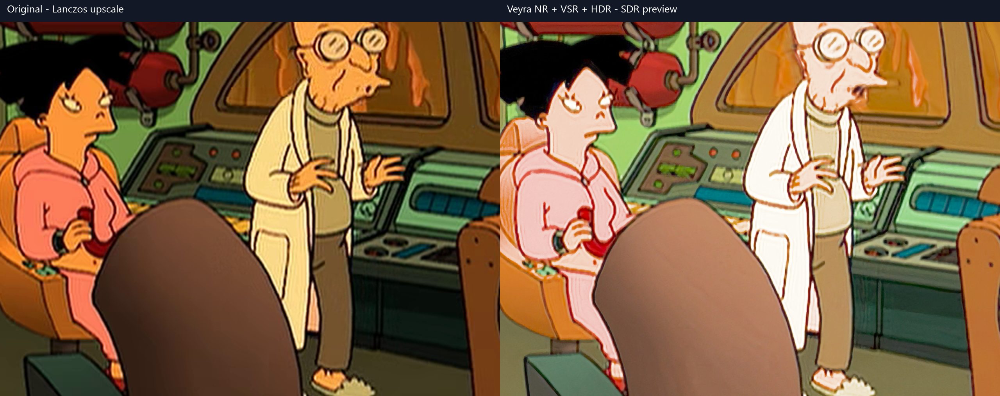
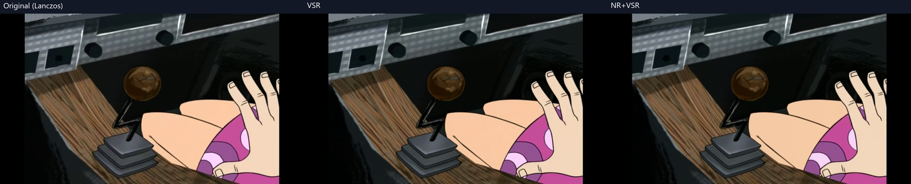

# Original / VSR / NR+VSR comparisons

[Overview](../README.md) · [Documentation](README.md) · [Settings](configuration.md)

**Left to right: Original (Lanczos) / VSR / NR+VSR.** The enhanced columns are real `testing-dlss` HEVC output, with neural rendering disabled for VSR and enabled for NR+VSR.

These are the same eight source selections, timestamps, and crop positions used on `main` and in the earlier DLSS comparisons. Original-column picture pixels are unchanged. Both enhanced columns were regenerated through this branch's shared server renderer, with identical settings apart from NR.

**HDR and interpolation are disabled in both enhanced columns.** All images are BT.709 SDR, without tone mapping or synthesized intermediate frames. This isolates NR's effect on the same source frame; it does not demonstrate HDR playback or motion quality. [Exact capture settings, frame identity, and hashes](assets/comparisons/dlss/capture.json).

NR output is converted from sRGB back to BT.709 before VSR. Earlier captures omitted that transfer conversion, lifting shadows and reducing saturation. These refreshed images use the corrected renderer. NR is forced on in the third column so it remains visible for comparison; Automatic animation playback uses the plain VSR path.

The overview images show all three whole frames, resized to a combined width of 1600 pixels for the page. Detail images contain three unresized 1280 × 960 crops from the matching 4K canvases. GitHub may shrink an image to fit the page; open it to inspect the original size. The WebP detail assets preserve every column's PNG crop pixels losslessly.

## Doctor Who — 720p live action

### Scene 1 · 14:59.45

[Inspect the detail crop](assets/comparisons/dlss/doctor-who-scene-1-detail.webp). This scene includes clothing, hair, and a screen within the picture.

### Scene 2 · 29:58.90

[View the whole frame](assets/comparisons/dlss/doctor-who-scene-2-overview.webp). Compare eyelashes, hair, skin texture, and edges around the on-screen graphics. Strong enhancement can change the appearance of fine texture.

## Futurama — 720p animation

### Scene 1 · 07:32.08

[View the whole frame](assets/comparisons/dlss/futurama-scene-1-overview.webp).

### Scene 2 · 15:04.16

[Inspect the detail crop](assets/comparisons/dlss/futurama-scene-2-detail.webp). Look at outlines, lettering, and ringing around high-contrast edges.

## The Venture Bros. — 480p animation

### Scene 1 · 07:35.25

[View the whole frame](assets/comparisons/dlss/venture-bros-scene-1-overview.webp).

### Scene 2 · 15:10.49

[Inspect the detail crop](assets/comparisons/dlss/venture-bros-scene-2-detail.webp). This pair shows an object close-up with diagonal lines and small details.

## Xena — 480p live action

**The provided source was 10-bit SDR.** It was converted to an 8-bit SDR intermediate before any column was generated. These images do not demonstrate native 10-bit input support. The original video was unchanged.

### Scene 1 · 14:45.49

[Inspect the detail crop](assets/comparisons/dlss/xena-scene-1-detail.webp). Dark textures make source noise and compression artifacts visible.

### Scene 2 · 29:30.98

[View the whole frame](assets/comparisons/dlss/xena-scene-2-overview.webp). Sharpening cannot reliably recover detail that is absent from a compressed source; judge noise and texture as well as edge definition.

## Capture profile

| Setting | Value |
| --- | --- |
| VSR quality | ULTRA |
| Strength | 1 |
| Processing canvas | 5120 × 2880 |
| Delivery canvas | 3840 × 2160 |
| Video | HEVC Main 10, 60 Mbps |
| NVENC preset / tune | p7 / hq |
| Lookahead / CQ | 12 / 1 |
| Spatial AQ / temporal AQ | On / off |
| Neural rendering | Off in VSR; Veyra experimental NR on in NR+VSR |
| NR profile | Animation for Futurama / The Venture Bros.; live action for Doctor Who / Xena |
| Auto HDR | Off in both enhanced columns |
| Adaptive interpolation | Off; every source frame is enhanced |
| Output frame rate | 24000/1001, matching these sources |
| Web preview | BT.709 SDR, without tone mapping |
| GPU used | NVIDIA GeForce RTX 4070 Ti SUPER |

This is a high-quality comparison profile, not the new-install default. Lookahead 12 selects the compatible FFmpeg encoder path. NVIDIA VSR enhancement still runs on the GPU, but this path transfers enhanced frames through system memory before encoding.

## How the three-way comparisons were made

1. The original lossless 8-bit sample clips were reused. They contain the two original intervals from each title. Xena retains the explicit bit-depth conversion described above.
2. Each clip contains 48 frames. Source frames 16 and 40 were checked pixel-for-pixel against the original native PNG captures before rendering.
3. The branch's real worker encoded each clip twice, with VSR and NR+VSR. Both runs use the server's frame-processing path and GPU delivery resize. Offline capture omits the playback startup preview so that the short samples show fully enhanced output. HDR and interpolation are off. The NR content profile was selected explicitly for this controlled capture; normal playback resolves it from Jellyfin title metadata.
4. Frames 16 and 40 were extracted from both HEVC outputs and checked against the original presentation clock. The original Lanczos canvases were reused unchanged. No HDR tone mapping was applied.
5. The same unresized 1280 × 960 crop rectangles were used in all three columns. Original-column picture pixels were checked against the earlier comparison, and all three columns were checked for distinct output. Lossless WebP conversion preserves every crop pixel. No additional sharpening was applied to the exported stills.

The repository contains 16 branch-specific three-way WebP images under `docs/assets/comparisons/dlss/`. The [capture record](assets/comparisons/dlss/capture.json) records source, encoded-output, frame, and asset hashes; profiles; and exact crop rectangles for all eight scenes. The original two-column SDR comparison assets remain available for reference.

To reproduce these captures with the prepared GPU runtime and the original comparison files, run `python tools/capture_dlss_comparisons.py --comparisons "path/to/comparison shots"`. The script verifies source identity, all 48 output frames in each variant, source FPS, SDR signaling, NR toggles, original-column pixels, and lossless crops before writing the capture record.

These stills do not measure temporal artifacts, sustained throughput, or long-session A/V drift. Sample footage belongs to its respective rights holders.
