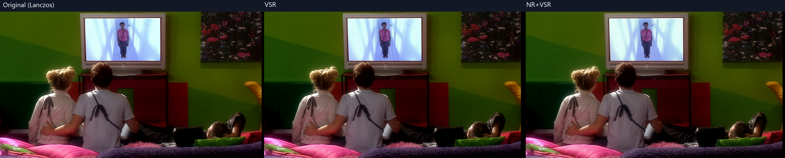
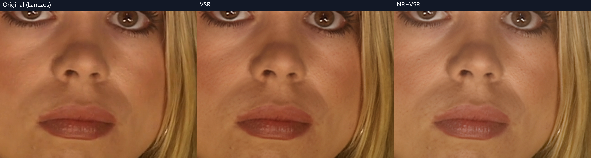
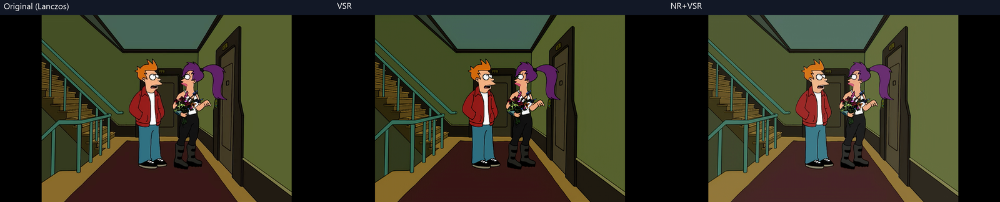
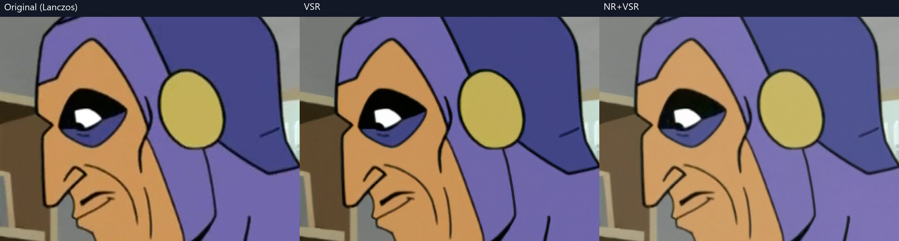
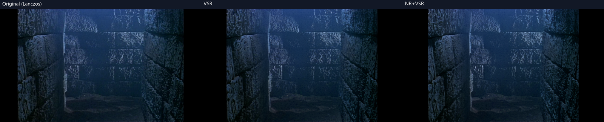
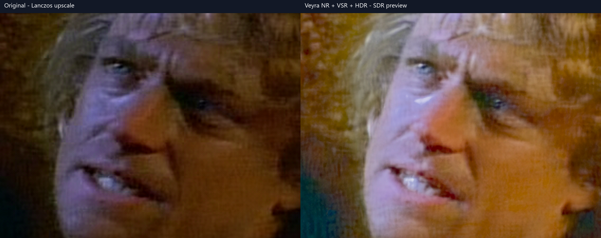

# DLSS-branch screenshot comparisons

[Overview](../README.md) · [Documentation](README.md) · [Settings](configuration.md)

**Left: original with Lanczos scaling. Right: actual `testing-dlss` HEVC output with Veyra neural rendering, NVIDIA VSR, Auto HDR, and adaptive interpolation enabled.**

These are the same eight source selections, timestamps, and crop positions used on `main`. The left-side picture pixels are unchanged. The right side was regenerated through this branch's worker at the matching source presentation time; interpolation may synthesize that frame between enhanced anchors.

The encoded output is HDR10. For GitHub display, the right-side images are converted to SDR using FFmpeg's Mobius tone mapping with a 1000-nit input peak and 100-nit reference. Brightness and color differences include that conversion. These previews cannot reproduce an HDR display's range or demonstrate interpolation in motion. [Exact capture settings, hashes, and interpolation anchors](assets/comparisons/dlss/capture.json).

The overview images show the whole picture, resized to 1600 pixels wide for the page. Detail images are unresized 1280 × 960 crops from each 4K canvas, placed side by side. GitHub may shrink an image to fit the page; open it to inspect the original size. The WebP detail assets preserve the PNG crop pixels losslessly.

## Doctor Who — 720p live action

### Scene 1 · 14:59.45

[Inspect the detail crop](assets/comparisons/dlss/doctor-who-scene-1-detail.webp). This scene includes clothing, hair, and a screen within the picture.

### Scene 2 · 29:58.90

[View the whole frame](assets/comparisons/dlss/doctor-who-scene-2-overview.webp). Compare eyelashes, hair, skin texture, and edges around the on-screen graphics. Strong enhancement can change the appearance of fine texture.

## Futurama — 720p animation

### Scene 1 · 07:32.08

[View the whole frame](assets/comparisons/dlss/futurama-scene-1-overview.webp).

### Scene 2 · 15:04.16

[Inspect the detail crop](assets/comparisons/dlss/futurama-scene-2-detail.webp). Look at outlines, lettering, and ringing around high-contrast edges.

## The Venture Bros. — 480p animation

### Scene 1 · 07:35.25

[View the whole frame](assets/comparisons/dlss/venture-bros-scene-1-overview.webp).

### Scene 2 · 15:10.49

[Inspect the detail crop](assets/comparisons/dlss/venture-bros-scene-2-detail.webp). This pair shows an object close-up with diagonal lines and small details.

## Xena — 480p live action

**The provided source was 10-bit SDR.** It was converted to an 8-bit SDR intermediate before either side was generated. These images do not demonstrate native 10-bit input support. The original video was unchanged.

### Scene 1 · 14:45.49

[Inspect the detail crop](assets/comparisons/dlss/xena-scene-1-detail.webp). Dark textures make source noise and compression artifacts visible.

### Scene 2 · 29:30.98

[View the whole frame](assets/comparisons/dlss/xena-scene-2-overview.webp). Sharpening cannot reliably recover detail that is absent from a compressed source; judge noise and texture as well as edge definition.

## Capture profile

| Setting | Value |
| --- | --- |
| VSR quality | ULTRA |
| Strength | 1 |
| Processing canvas | 5120 × 2880 |
| Delivery canvas | 3840 × 2160 |
| Video | HEVC Main 10, 60 Mbps |
| NVENC preset / tune | p7 / hq |
| Lookahead / CQ | 12 / 1 |
| Spatial AQ / temporal AQ | On / off |
| Neural rendering | Veyra experimental NR, enabled |
| NR profile | Animation for Futurama / The Venture Bros.; live action for Doctor Who / Xena |
| Auto HDR | Enabled, 1000-nit peak |
| Adaptive interpolation | Enabled; output retains source FPS |
| Output frame rate | 24000/1001, matching these sources |
| Web preview | HDR tone-mapped to SDR with Mobius |
| GPU used | NVIDIA GeForce RTX 4070 Ti SUPER |

This is a high-quality comparison profile, not the new-install default. Lookahead 12 selects the compatible FFmpeg encoder path. NVIDIA VSR enhancement still runs on the GPU, but this path transfers enhanced frames through system memory before encoding.

## How the pairs were made

1. The original lossless 8-bit sample clips were reused, rather than seeking again into the videos. They contain the two original intervals from each title. Xena retains the explicit bit-depth conversion described above.
2. Each clip contains 48 frames. Source frames 16 and 40 were checked pixel-for-pixel against the original native PNG captures before rendering.
3. The branch's real worker encoded each clip with NR, VSR, HDR, and adaptive interpolation enabled. The content profile was selected explicitly for this controlled capture; normal playback resolves it from Jellyfin title metadata.
4. Frames 16 and 40 were extracted from the encoded HEVC output, checked against the original presentation clock, and tone-mapped for this SDR web page. The original Lanczos canvases were reused unchanged.
5. The same overview dimensions and unresized 1280 × 960 crops were used. Every detail panel's left-side picture pixels were checked against the previous branch image; every right side was checked to contain new output. Lossless WebP conversion preserves the crop pixels. No additional sharpening was applied to the exported stills.

The repository contains 16 branch-specific WebP images under `docs/assets/comparisons/dlss/`. The [capture record](assets/comparisons/dlss/capture.json) records source and asset hashes, profiles, exact crop rectangles, and interpolation anchors for all eight scenes. The original SDR comparison assets remain available for reference.

To reproduce these captures with the prepared GPU runtime and the original comparison files, run `python tools/capture_dlss_comparisons.py --comparisons "path/to/comparison shots"`. The script verifies source identity, all 48 output frames, source FPS, HDR signaling, original-side pixels, and lossless crops before writing the capture record. The HDR preview conversion follows [FFmpeg's tone-mapping requirements](https://github.com/FFmpeg/FFmpeg/blob/master/doc/filters.texi#tonemap).

These stills do not measure temporal artifacts, sustained throughput, or long-session A/V drift. Sample footage belongs to its respective rights holders.
