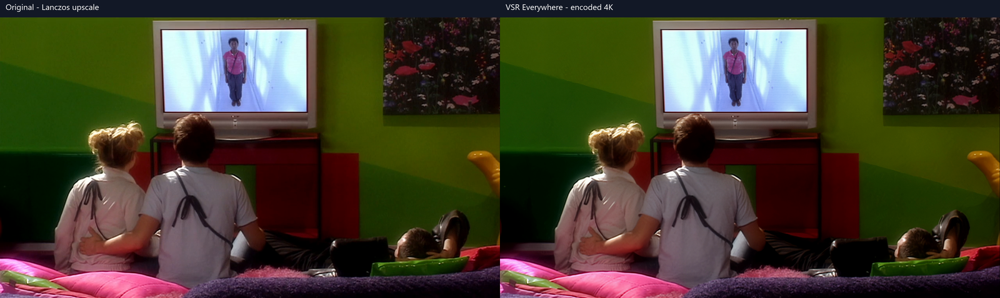
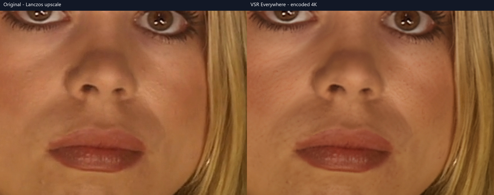
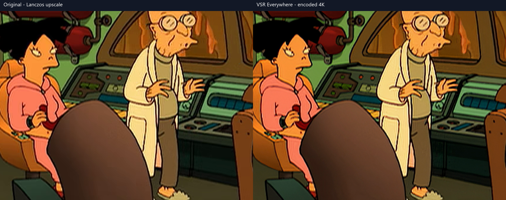
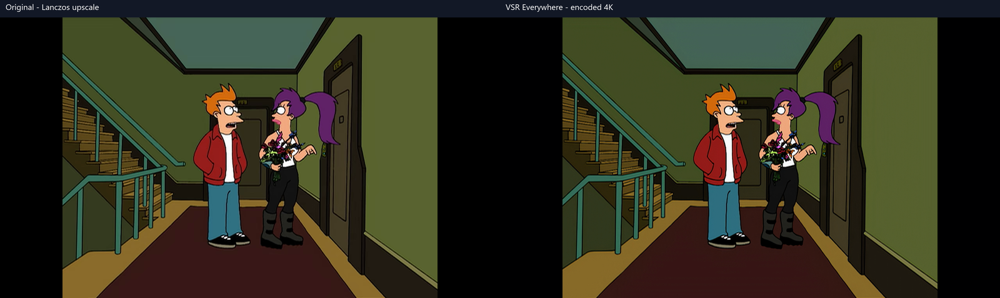
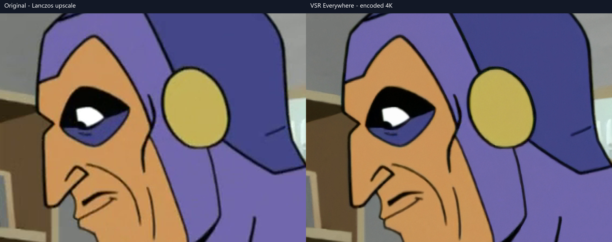
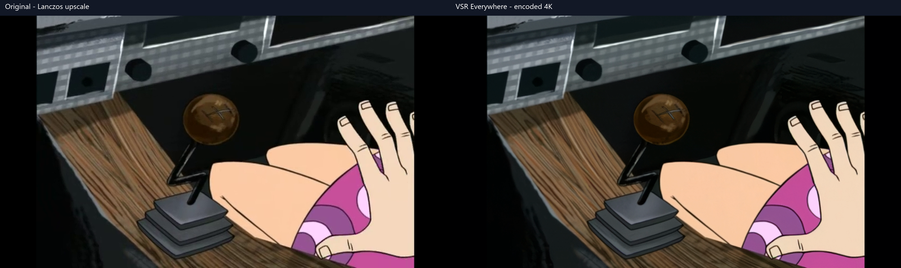
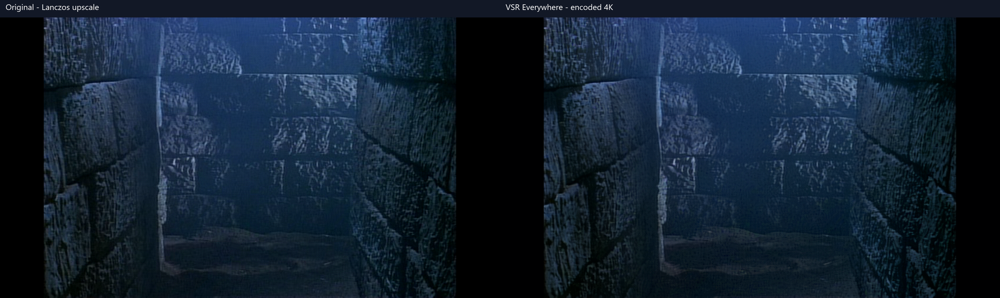
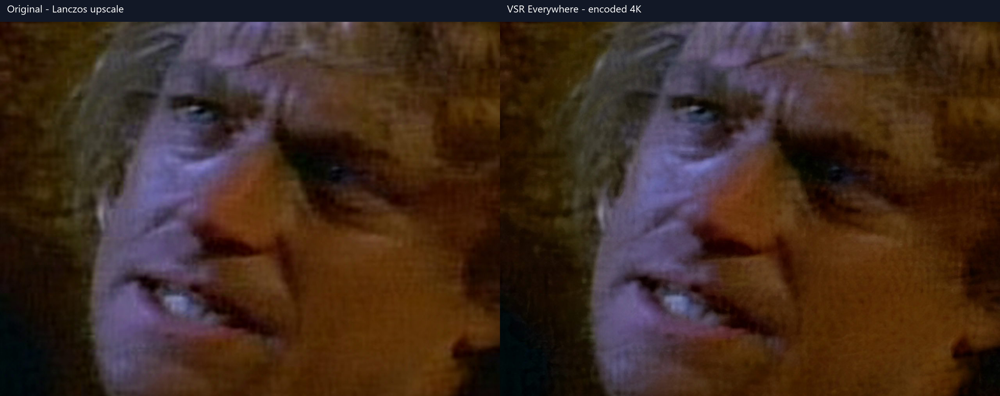

# Screenshot comparisons

[Overview](../README.md) · [Documentation](README.md) · [Settings](configuration.md)

**Left: original with Lanczos scaling. Right: a frame decoded from the actual VSR worker's HEVC output.**

The overview images show the whole picture, resized to 1600 pixels wide for the page. Detail images are unresized 1280 × 960 crops from each 4K canvas, placed side by side. GitHub may shrink an image to fit the page; open it to inspect the original size. The WebP detail assets preserve the PNG crop pixels losslessly.

## Doctor Who — 720p live action

### Scene 1 · 14:59.45

[Inspect the detail crop](assets/comparisons/doctor-who-scene-1-detail.webp). This scene includes clothing, hair, and a screen within the picture.

### Scene 2 · 29:58.90

[View the whole frame](assets/comparisons/doctor-who-scene-2-overview.webp). Compare eyelashes, hair, skin texture, and edges around the on-screen graphics. Strong enhancement can change the appearance of fine texture.

## Futurama — 720p animation

### Scene 1 · 07:32.08

[View the whole frame](assets/comparisons/futurama-scene-1-overview.webp).

### Scene 2 · 15:04.16

[Inspect the detail crop](assets/comparisons/futurama-scene-2-detail.webp). Look at outlines, lettering, and ringing around high-contrast edges.

## The Venture Bros. — 480p animation

### Scene 1 · 07:35.25

[View the whole frame](assets/comparisons/venture-bros-scene-1-overview.webp).

### Scene 2 · 15:10.49

[Inspect the detail crop](assets/comparisons/venture-bros-scene-2-detail.webp). This pair shows an object close-up with diagonal lines and small details.

## Xena — 480p live action

**The provided source was 10-bit SDR.** It was converted to an 8-bit SDR intermediate before either side was generated. These images do not demonstrate native 10-bit input support. The original video was unchanged.

### Scene 1 · 14:45.49

[Inspect the detail crop](assets/comparisons/xena-scene-1-detail.webp). Dark textures make source noise and compression artifacts visible.

### Scene 2 · 29:30.98

[View the whole frame](assets/comparisons/xena-scene-2-overview.webp). Sharpening cannot reliably recover detail that is absent from a compressed source; judge noise and texture as well as edge definition.

## Capture profile

| Setting | Value |
| --- | --- |
| VSR quality | ULTRA |
| Strength | 1 |
| Processing canvas | 5120 × 2880 |
| Delivery canvas | 3840 × 2160 |
| Video | HEVC Main 10, 60 Mbps |
| NVENC preset / tune | p7 / hq |
| Lookahead / CQ | 12 / 1 |
| Spatial AQ / temporal AQ | On / off |
| GPU used | NVIDIA GeForce RTX 4070 Ti SUPER |

This is a high-quality comparison profile, not the new-install default. Lookahead 12 selects the compatible FFmpeg encoder path. NVIDIA VSR enhancement still runs on the GPU, but this path transfers enhanced frames through system memory before encoding.

## How the pairs were made

1. Two short intervals were selected from each user-provided video, at roughly one-third and two-thirds of its duration.
2. Lossless 8-bit intermediates kept frame selection consistent. Xena required the explicit bit-depth conversion described above.
3. Each video supplied 48 frames to the installed worker code. Frames 16 and 40 were selected from both the decoded input and encoded result, allowing preceding frames before each capture.
4. The original side used Lanczos scaling with the same processing/delivery geometry. The VSR side came from the worker's actual HEVC output.
5. Output frame counts, PNG dimensions, source-frame identity, and crop pixels were checked. No extra sharpening or image enhancement was applied to the exported stills.

The repository contains smaller lossless WebP overviews and full-size lossless WebP detail panels. The separate **VSR-Everywhere-Comparison-Shots.zip** contains all 40 PNGs, including native source frames and individual 4K canvases. Attach that archive to a release when making the complete image set available.

These stills do not measure temporal artifacts, sustained throughput, or long-session A/V drift. Sample footage belongs to its respective rights holders.
