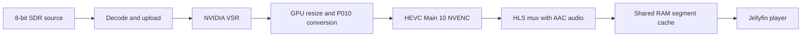

# Development and validation

[Overview](../README.md) · [Documentation](README.md) · [Release preparation](releasing.md)

## Source layout

| Path | Purpose |
| --- | --- |
| `src/Jellyfin.Plugin.VsrEverywhere/` | Jellyfin integration, device/settings page, memory store, HLS endpoints, and session/seek control. |
| `worker/` | Python VSR, GPU conversion/encoding, compatible encoding, and persistent-worker control. |
| `installer/` | Windows wizard/bootstrap, dependency lock, runtime assembly, and deployment/rollback engine. |
| `tests/` | Worker, settings, memory, transport, and playback checks. |
| `tools/` | Benchmark and comparison utilities. |
| `docs/` | User/developer guides and screenshot assets. |
| `dist/` | Generated release files; excluded from Git. |

## Playback pipeline



This diagram shows the direct GPU encoder path. Lookahead above 0 selects compatible FFmpeg encoding and copies enhanced frames through RAM. Completed encoded segments use the bounded RAM store; memory fallback can use disk. A persistent worker can retain the VSR model while the server requests uncached seek ranges.

## Build

Use Windows x64 with the **.NET 10 SDK**. From the repository root:

```powershell
powershell.exe -NoProfile -ExecutionPolicy Bypass -File .\Build-Installer.ps1
```

This builds the plugin and generates the EXE, matching ZIP/PowerShell pair, plugin ZIP, and source ZIP in `dist/`. It does not install the plugin or stop Jellyfin. The bootstrap uses the Windows .NET Framework compiler.

To build only the plugin:

```powershell
powershell.exe -NoProfile -ExecutionPolicy Bypass -File .\Build-Windows.ps1
```

The pinned dependency manifest is `installer/downloads.lock.json`. The wizard downloads its private runtime from those publisher URLs and verifies the recorded SHA-256 hashes. Review manifest changes together with runtime verification; `installer/Resolve-Downloads.py` is the maintainer utility for refreshing the lock.

## Checks

Use Node.js for settings checks, .NET 10 for plugin checks, and a Python environment with the worker requirements installed for Python checks. GPU/codec tests additionally need the NVIDIA runtime and FFmpeg.

```powershell
node tests/settings.test.cjs
python -m unittest discover -s tests -p "test_*.py"
dotnet run --project tests/PluginChecks/PluginChecks.csproj -c Release
powershell.exe -NoProfile -ExecutionPolicy Bypass -File installer/tests/Test-Installer.ps1
python installer/tests/Test-Package.py
```

The package check runs after building. It verifies that the EXE embeds the same ZIP and PowerShell file as the standalone artifacts, checks payload hashes and current sources, rejects an invalid manifest encoding, and confirms the documentation is included in the source archive.

Installer fixtures cover settings migration, local-folder routing, downloads, simultaneous log reads/writes, fresh startup confirmation, deployment, and rollback. Transport/playback integration checks are separate from the basic CPU/configuration checks.

## Evidence and limits

Validation performed during 1.0.0 development included:

- Real VSR, HEVC Main 10, AAC, and HLS output on an RTX 4070 Ti SUPER.
- 5K processing with 4K delivery.
- Forward/backward seeking around the 40-minute point of a two-hour synthetic source, using both MPEG-TS and fMP4.
- RAM transport/cache checks, worker/model retention, configuration/UI checks, and deployment/rollback fixtures.
- Eight still comparisons with matched source-frame indices and pixel-exact detail crops.
- Frame-order checks over 10,800 frames across six samples, including timestamp jitter, packed B-frames, and pixel-matched forward/backward seeks.
- Maintainer-confirmed playback on Jellyfin Roku 3.2.4 with MPEG-TS after the pacing repair.

This is not a claim of continuous two-hour playback, universal player compatibility, or sustained real-time speed at every preset. Clean-PC installation and a long-duration A/V-drift test remain unverified.
